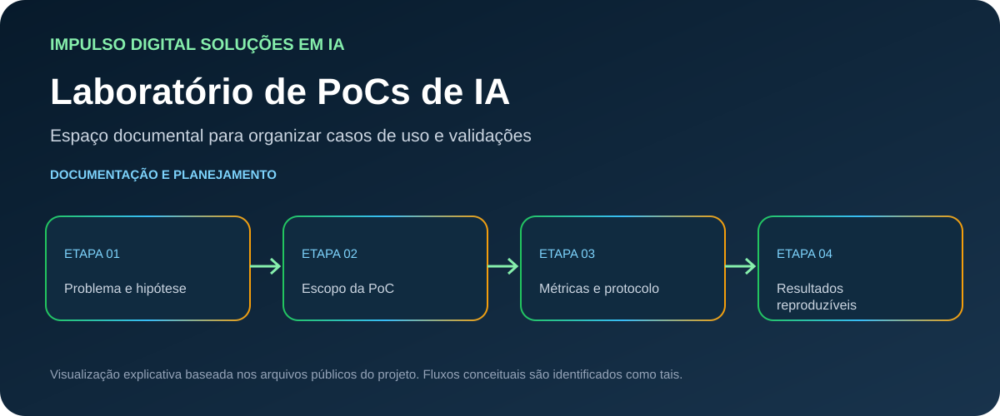

 | [](LICENSE) | [](https://github.com/sponsors/felipetjmg1-bit)

<p align="center"></p>


# Laboratório de Provas de Conceito de IA

## Visão geral

O README apresenta o projeto como um laboratório de soberania digital associado à Impulso Digital, destinado a demonstrações técnicas e resultados de ROI de automações com IA, e cita IA e Blockchain. A árvore pública, porém, contém somente o README; não há PoC, demonstração ou resultado verificável no conteúdo versionado consultado.

## Objetivo e valor

**Problema/escopo:** Repositório de documentação para iniciativas e provas de conceito de IA e automação associadas à soberania digital. A implementação e as demonstrações ainda não estão presentes na árvore pública consultada.

**Valor verificável hoje:** o repositório torna explícitos seus artefatos, interfaces e limitações para que mantenedores e contribuidores possam avaliar o que existe sem confundir demonstração, proposta e produção.

## Arquitetura e tecnologias

Não documentada. A árvore recursiva da branch main contém apenas README.md; não foram encontrados componentes ou arquivos de implementação que permitam inferir arquitetura.

- README em português.
- Nenhuma linguagem de programação ou stack identificável: a API de linguagens retorna vazio e não há código ou manifesto na árvore pública.
- O README menciona IA, Blockchain e automações como propósito, sem identificar tecnologias concretas ou dependências.

## Início rápido

Este repositório não fornece atualmente uma sequência verificável de instalação e execução de software. Para consultar os materiais disponíveis:

```bash
git clone https://github.com/felipetjmg1-bit/Provas-de-Conceito-IA.git
cd Provas-de-Conceito-IA
```

Não há comando de runtime documentado nos arquivos auditados.


## Exemplo de uso

Uso verificável limitado a consultar o README pela interface web pública do GitHub. Não há interface de demonstração, comando ou implementação no repositório que sustente outro exemplo de uso.

## Estado e limitações

**Maturidade indicada:** Conceito e documentação.

- Não deduzir implementação de IA, blockchain, automação ou soberania operacional apenas pelas afirmações de propósito: a árvore consultada contém somente README.md.
- Não propor comandos de instalação/execução, API, testes ou recursos funcionais; nenhum deles é comprovado pelo conteúdo disponível.
- A listagem de .github/workflows não retornou conteúdo, e a árvore recursiva não inclui workflows; não há CI/workflow versionado visível na branch consultada.

## Contribuição

Leia [CONTRIBUTING.md](CONTRIBUTING.md) antes de abrir uma issue ou pull request. Para reportes de segurança, siga a orientação específica do repositório, se houver.

## Licença

Este repositório está licenciado sob **MIT**; consulte [LICENSE](LICENSE).

## Patrocínio e apoio

O desenvolvimento aberto exige tempo para manutenção, documentação, testes, revisão de contribuições e resposta a issues. Se este projeto for útil, considere apoiar a continuidade pelo [GitHub Sponsors](https://github.com/sponsors/felipetjmg1-bit). O apoio não representa promessa de funcionalidades, prazo de entrega ou suporte comercial.

[](https://github.com/sponsors/felipetjmg1-bit)


**Empresa responsável:** Impulso Digital Soluções em IA.


## Fluxo passo a passo

Consulte o [guia textual com as etapas do projeto](docs/PROCESSO-PASSO-A-PASSO.md). O infográfico acima resume visualmente o mesmo fluxo.
